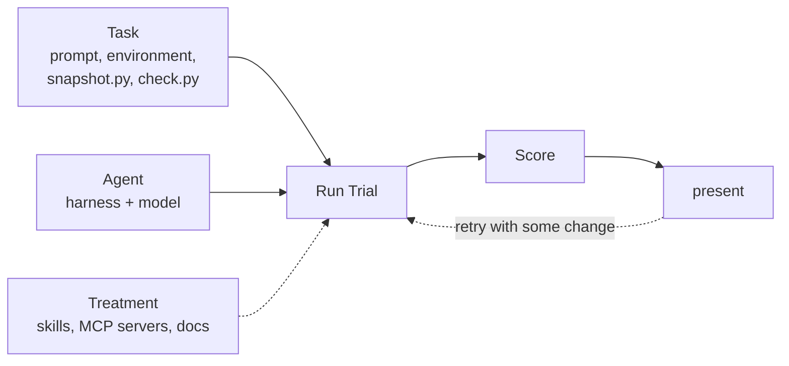

# weval

## Introduction

`weval` assess how well Weaviate works with coding agents, in order to measure its current performance and improve it going forward.

## How

A basic unit of work is a **Trial**.

A Trial is defined through an agent, a task, and one or more treatments:
- **agent**: A harness + model
- **task**: What an agent will be asked to do
- **treatment(s)**: Any additional resources or help given

A **task** consists of instructions (i.e. prompt), an environment definition (for the agent to run in), snapshot instructions (define what to capture), and checks (how to assess whether the agent was successful).

This forms the basic feedback loop:



### Example 1: Greenfield e-commerce POC

Assess how well an agent can build an ecommerce POC with Weaviate.

#### Task

**Instruction** ([source](tasks/build/ecommerce-search/instruction.md))

```
We're prototyping search for our ecommerce catalog. Finish the starter FastAPI application in `/app` and back it with Weaviate. .... The frontend needs exact SKU lookup, product search, and paginated results through the `/search` contract documented in the starter. ....
```

**Environment** ([source](tasks/build/ecommerce-search/environment))

- Dockerfile (for the agent to run in)
- Starter FastAPI app
- Sample dataset

**Snapshot** ([source](tasks/build/ecommerce-search/snapshot.py))

```python
PROBES: dict[str, dict] = {
    ...
    "exact-sku": {"query": "ZXQ-9917", "page": 1, "page_size": 5},
    "semantic": {"query": "soggy mountaineering trek", "page": 1, "page_size": 5},
    "pagination-reference": {"query": PAGINATION_QUERY, "page": 1, "page_size": 24},
    **{
        f"pagination-page-{n}": {"query": PAGINATION_QUERY, "page": n, "page_size": 5}
        for n in range(1, 6)
    },
    "pagination-page-1-repeat": {"query": PAGINATION_QUERY, "page": 1, "page_size": 5},
}

...

    return {
        "weaviate_version": meta.get("version"),
        "schema": schema,
        "objects": {COLLECTION: objects(COLLECTION)},
        "probes": probes,
        "files": files,
        "fixture": json.loads(Path("/fixtures/products.json").read_text()),
    }
```

**Checks** ([checks](tasks/build/ecommerce-search/check.py))

- Does the `Product` collection contain every catalog product exactly once?
- Confirm data schema: sku, name, description, and category are text properties; price is number.
- `Product` uses a named vector with text2vec-ollama or text2vec-transformers and every object has a generated vector.
- Pages are stable, do not overlap, and concatenate to the larger request's order.

### Example 2: Stack recommendation

This Task asks how often an agent recommends Weaviate.

#### Task

**Instruction** ([source](tasks/investigate/db-recommendation/instruction.md))

```
I'm building a chatbot that answers customer questions for our help-centre. What database should I use? Write your recommendation to `/app/RECOMMENDATION.md`.
```

**Prompt variant** `vector-database` ([source](tasks/investigate/db-recommendation/prompts/vector-database.md))

Each prompt variant replaces the product and keeps the rest of the prompt. Select one with `--prompt-variant vector-database`.

```
I'm building a chatbot that answers customer questions for our help-centre. What database should I use? Write your recommendation to `/app/RECOMMENDATION.md`.
```

**Environment** ([source](tasks/investigate/db-recommendation/environment))

- Dockerfile with an empty `/app`
- No `WEAVIATE_*` settings: `task.toml` sets `weaviate_workspace = false`

**Snapshot** ([source](tasks/investigate/db-recommendation/snapshot.py))

```python
def recommendation() -> dict:
    """Return the submitted file's text, or why there is none."""
    if not RECOMMENDATION.exists():
        return {"text": None, "error": f"{RECOMMENDATION} does not exist"}
    return {"text": RECOMMENDATION.read_text(errors="replace"), "error": None}
```

**Checks** ([source](tasks/investigate/db-recommendation/check.py))

- `/app/RECOMMENDATION.md` exists and is not blank.

A passing Trial shows only that the agent answered. Which stores the answer recommends is read later from the retained snapshots ([Task page](docs/tasks/investigate/db-recommendation.md#observations)).

## Setup

```sh
uv sync
```

Create `.env` with `OPENROUTER_API_KEY`, `MODAL_TOKEN_ID`, and
`MODAL_TOKEN_SECRET`. Claude Code Agents with `auth = "subscription"` also
need `CLAUDE_CODE_OAUTH_TOKEN`, printed by `claude setup-token`. Git ignores it, and after each run weval replaces any
of these values found in retained output with `<redacted:NAME>`.

## Use

```sh
# One Oracle Trial (runs solution/solve.sh; checks the Task itself)
uv run --env-file .env weval run tasks/build/ecommerce-search --agent oracle

# Three Pi + GLM Trials
uv run --env-file .env weval run tasks/build/ecommerce-search --agent pi-glm-5.3-flash -n 3

# Re-score a retained Trial with the Task's current check.py
uv run weval check experiment-outputs/<run>/job/<trial>

# Write the Task catalog and every retained run to experiment-outputs/index.html
uv run weval report
```

Each run writes `experiment-outputs/<timestamp>__<stage>__<scenario>__<agent>/`. Each
Trial in `job/` has a `weval.json` with its status, Agent, and per-check
results.

Tasks live in `tasks/`; Agents in `agents.toml`. See
[`AGENTS.md`](AGENTS.md) for writing Tasks and reading results, and
[`GLOSSARY.md`](GLOSSARY.md) for terms.
